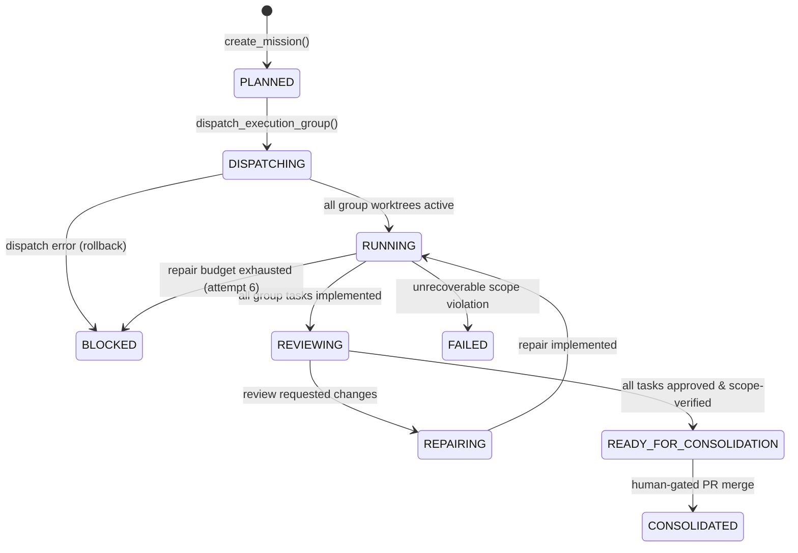
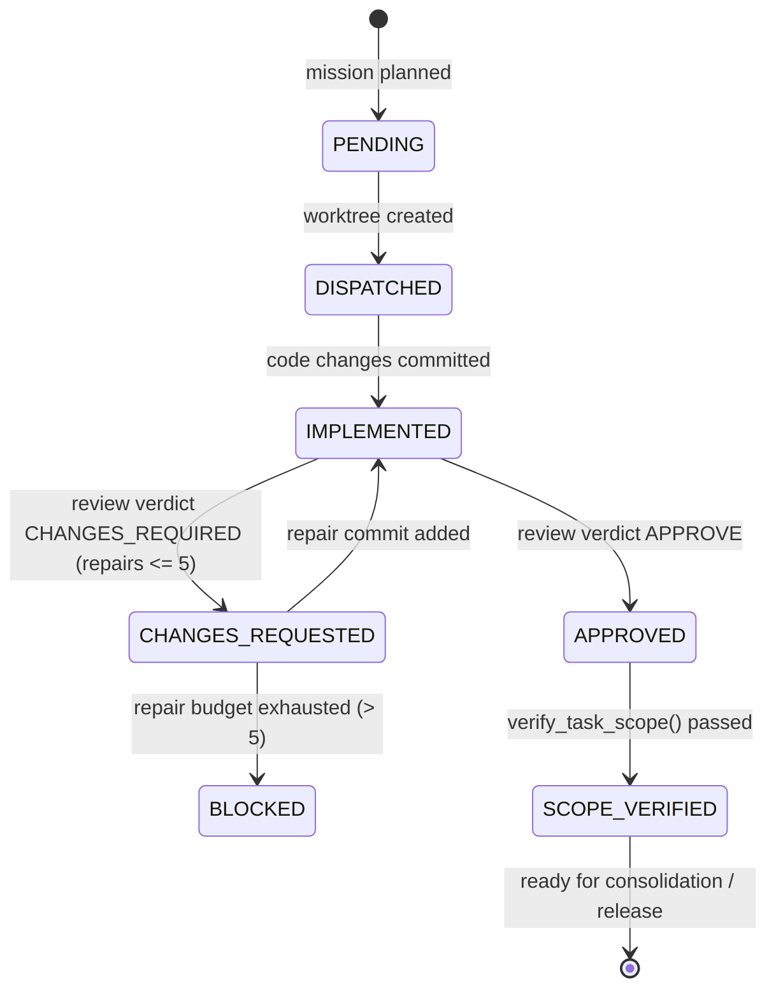

# TapJob Agent Factory — AF-2 Multi-Agent Parallel Execution & Consolidation

## 1. Overview & Objective

The TapJob Agent Factory AF-2 milestone extends the operational multi-agent capabilities established in AF-1 (formal team instantiation and isolated worktree dispatch) into an automated, deterministic framework for **Multi-Agent Parallel Execution and Consolidation Gating** under Google Antigravity 2.0.

AF-2 allows the Engineering Manager to take a high-level engineering mission, decompose it into a structured directed acyclic graph (DAG) of task contracts, partition those tasks into deterministic execution groups, execute independent tasks concurrently across isolated Git worktrees, supervise parallel repair loops with strict reviewer separation, enforce exact scope boundaries, and evaluate an automated readiness gate for branch consolidation **without performing autonomous merges**.

---

## 2. Architecture & Components

The AF-2 parallel execution subsystem is built strictly around four repository-side components and their integration with Antigravity 2.0 runtime primitives:

```
+--------------------------------------------------------------------------------------------------+
|                                    Google Antigravity 2.0                                        |
|  +--------------------+    +-----------------------+    +-------------------------------------+  |
|  |   define_subagent  |    |    invoke_subagent    |    |           send_message              |  |
|  +--------------------+    +-----------------------+    +-------------------------------------+  |
+---------------------------------------------|----------------------------------------------------+
                                              | Orchestrates
                                              v
+--------------------------------------------------------------------------------------------------+
|                                  TapJob Agent Factory (AF-2)                                     |
|                                                                                                  |
|   +-----------------------+       Deterministic       +-----------------------+                  |
|   |    MissionContract    | ------------------------> |    MissionPlanner     |                  |
|   | (schema, DAG, SHA-40) |                           |  (toposort, groups)   |                  |
|   +-----------------------+                           +-----------------------+                  |
|               |                                                   |                              |
|               | State Persistence                                 | Execution Plan               |
|               v                                                   v                              |
|   +-----------------------+  Process-Safe Lock File   +-----------------------+                  |
|   |    MissionRegistry    | <-----------------------> |  MissionCoordinator   |                  |
|   |  (atomic, multi-PID)  |                           |  (dispatch, review)   |                  |
|   +-----------------------+                           +-----------------------+                  |
|                                                                   |                              |
|                                                 Worktree Control  v                              |
|                                                       +-----------------------+                  |
|                                                       |  WorktreeDispatcher   |                  |
|                                                       | (worktrees, registry) |                  |
|                                                       +-----------------------+                  |
+--------------------------------------------------------------------------------------------------+
```

### 2.1 MissionContract (`tools/agent_factory/mission_contract.py`)
Represents an immutable, strongly typed engineering mission:
- **`mission_id`**: Non-empty identifier adhering to `^[a-zA-Z0-9_-]+$`.
- **`canonical_base_sha`**: Exact 40-character hexadecimal commit SHA pinned across the entire mission.
- **`objective`**: Human-readable definition of the intended engineering outcome.
- **`tasks`**: Ordered sequence of `TaskContract` items forming the execution DAG.
- **Strict Invariants**:
  - All child tasks inherit and must match the mission's exact `canonical_base_sha`.
  - All `task_id` values within a mission must be globally unique.
  - All `target_branch` values within a mission must be distinct.
  - Every dependency declared in `task.dependencies` must reference a valid `task_id` defined within the mission.

### 2.2 MissionPlanner (`tools/agent_factory/mission_planner.py`)
Computes an immutable `ExecutionPlan` consisting of sequential `ExecutionGroup` stages:
- **Topological Sorting & Cycle Detection**: Builds an adjacency graph and computes in-degrees. Detects dependency cycles fail-closed via DFS.
- **Critical Serial Path Isolation**: Any task whose `allowed_paths` touch `CRITICAL_SERIAL_PATHS` (such as `.agents/`, `tools/agent_guard/`, `packages/contracts/`, `infra/`, etc.) is strictly isolated into a single-task execution group (`is_parallel=False`), regardless of dependency depth.
- **Pairwise Conflict Avoidance**: Tasks in the same dependency layer are checked for path overlap (`check_ownership_conflict`). Conflicting tasks are automatically partitioned into successive execution groups to guarantee collision-free concurrent execution.
- **Determinism**: Sorting and grouping use deterministic lexical ordering on `task_id` to ensure reproducible execution plans across processes and test environments.

### 2.3 MissionRegistry (`tools/agent_factory/mission_registry.py`)
Provides persistent, crash-resilient storage for mission state outside the repository (`<worktrees_dir>/.tapjob-agent-factory/missions/<mission_id>.json`):
- **Cross-Process Mutex**: Uses directory-based lock files (`.mission_lock`) containing PID, token, and timestamp. Dead-process locks are detected and safely reclaimed via OS-level PID liveness checks (`ctypes.windll.kernel32.OpenProcess` on Windows, `os.kill(pid, 0)` on POSIX).
- **Atomic Writes**: Writes mission records to temporary files followed by atomic filesystem replacement (`os.replace`) to prevent corruption from abrupt aborts.
- **Strict Validation**: Fails closed if any registry file contains missing fields, unparseable states, or inconsistent task states.

### 2.4 MissionCoordinator (`tools/agent_factory/mission_coordinator.py`)
Executes the mission lifecycle and orchestrates worktree dispatch:
- **Group Dispatching**: Coordinates parallel worktree creation via `WorktreeDispatcher`.
- **Partial Dispatch Safe Halting**: If any task in an execution group fails to dispatch, already dispatched tasks in the group are safely recorded in their current active state, the failing task records its failure, undispatched tasks remain `PENDING`, and the mission transitions to `BLOCKED` to halt unattended progression without destroying already allocated state.
- **Reviewer Separation**: Enforces that the reviewer role cannot match the implementing owner role (`ReviewerSeparationError`).
- **Bounded Repair Loop**: Enforces `MAX_INTERNAL_REPAIR_LOOPS = 5`. On the 6th failed attempt, the task transitions to `BLOCKED` and halts autonomous dispatch, escalating to human intervention.
- **Exact TOCTOU Scope Verification**: Verifies committed diffs and working directory cleanliness against the assigned `allowed_paths`. Freezes the exact verified HEAD commit SHA.
- **Consolidation Readiness Gate**: Evaluates all tasks across the mission to ensure:
  1. All tasks are `SCOPE_VERIFIED`.
  2. Every task has a formal `APPROVE` verdict from an independent reviewer role.
  3. No task exceeded the repair budget.
  4. All worktrees remain clean with zero uncommitted changes.
  5. Current worktree HEAD matches the exact `scope_verified_head_sha` recorded during review (preventing post-review rogue commits).

---

## 3. Mission & Task Lifecycle State Machines

### 3.1 Mission State Machine (`MissionState`)



### 3.2 Task Mission State Machine (`TaskMissionState`)



---

## 4. Invariants & Safety Boundaries

1. **Strictly No Autonomous Merging**: The Agent Factory and `MissionCoordinator` evaluate readiness and report `READY_FOR_CONSOLIDATION`. Branch merging remains strictly human-gated (`gh pr merge` is prohibited in autonomous workflows).
2. **Reviewer Separation of Duties**: The task implementer can never approve their own work. Code reviews require an independent reviewer role (e.g., `reviewer_security_engineer` or `qa_sdet_engineer`).
3. **Repair Budget Guard**: Internal repair loops are strictly bounded to 5 attempts. A 6th attempt triggers an uncatchable escalation to human operators.
4. **Time-of-Check to Time-of-Use (TOCTOU) Protection**: Scope verification freezes the verified HEAD commit SHA. Any subsequent commit added to the worktree before consolidation invalidates readiness.
5. **No Direct Main Commits**: All worktree branches are restricted to feature conventions (`chore/`, `feat/`, `fix/`, `docs/`, `test/`, `security/`, `ops/`). Direct checkouts of `main` or `master` fail closed.
6. **Zero Product Alterations in Governance Scope**: AF-2 modifies zero Career Core or mobile code. It is purely agent infrastructure.

---

## 5. Live Multi-Agent Runtime Proof Evidence

A real, end-to-end multi-agent execution was performed under Google Antigravity 2.0 to validate the AF-2 architecture in live operation with real Git commits and reviewer cycles.

### 5.1 Mission Definition & Dispatch
- **Mission ID**: `af2-live-proof-round2`
- **Canonical Base SHA**: `401b7aeb51a538ca63c067f1c51891ba71bd2921`
- **Tasks**:
  1. `af2-proof-task-doc`: Assigned to `engineering_manager`, target branch `feat/af2-proof-task-doc`, allowed paths `["docs/agent-factory/proof/af2_proof_notes.md"]`.
  2. `af2-proof-task-qa`: Assigned to `qa_sdet_engineer`, target branch `feat/af2-proof-task-qa`, allowed paths `["tests/fixtures/af2_proof_fixture.json"]`.
- **Planning Result**: Group 0 contained both tasks concurrently (`parallel=True`).
- **Dispatch**:
  - Worktree 1: `C:\Projetos\tapjob-worktrees\af2-proof-task-doc` on branch `feat/af2-proof-task-doc`
  - Worktree 2: `C:\Projetos\tapjob-worktrees\af2-proof-task-qa` on branch `feat/af2-proof-task-qa`

### 5.2 Antigravity Subagent Registration & Invocation
Two specialized Antigravity subagents were defined and invoked concurrently:
1. **`af2_live_worker_doc`** (Conversation ID: `a549caca-9972-4205-852d-49ad8488a71e`):
   - Role: `AF2 Live Doc Worker`
   - Generated file: `docs/agent-factory/proof/af2_proof_notes.md`
   - Initial commit: `d691aa61f6e7d089508256f0ec9c0aad6928c829` (`feat(docs): initial draft of AF-2 parallel proof notes`)
2. **`af2_live_worker_qa`** (Conversation ID: `955b82b2-85a1-4529-aee1-c740bdb40935`):
   - Role: `AF2 Live QA Worker`
   - Generated file: `tests/fixtures/af2_proof_fixture.json`
   - Initial commit: `89ce8a1c8d6d57cd0dd0ec059b6fc2f891290150` (`feat(qa): add AF-2 parallel execution QA fixture`)

### 5.3 Repair Loop & Independent Review
- **Task 1 Review & Repair Cycle (`af2-proof-task-doc`)**:
  1. `reviewer_security_engineer` issued verdict `CHANGES_REQUIRED` (`test_passed=False`, findings: `Finding: Document lacks mandatory architecture alignment section.`). Task state transitioned to `CHANGES_REQUESTED` (`repair_count: 1`).
  2. Subagent `af2_live_worker_doc` performed repair in the worktree, adding the required architecture section and committing:
     - Repair commit: `716dd487d0fd9015c26a659141126cb8d0261343` (`fix(docs): add architecture alignment section per review finding`)
  3. `reviewer_security_engineer` re-reviewed the updated worktree and issued verdict `APPROVE` (`test_passed=True`). Task state transitioned to `APPROVED`.
- **Task 2 Review Cycle (`af2-proof-task-qa`)**:
  1. `reviewer_security_engineer` issued verdict `APPROVE` (`test_passed=True`) on first pass. Task state transitioned to `APPROVED`.

### 5.4 Exact Scope Verification & Consolidation Readiness
- Exact scope verification executed on both worktrees via `coordinator.verify_task_scope`:
  - `af2-proof-task-doc`: `SCOPE_VERIFIED` at exact repair HEAD `716dd487d0fd9015c26a659141126cb8d0261343`.
  - `af2-proof-task-qa`: `SCOPE_VERIFIED` at exact initial HEAD `89ce8a1c8d6d57cd0dd0ec059b6fc2f891290150`.
- Deterministic consolidation evaluation executed via `coordinator.check_consolidation_readiness("af2-live-proof-round2")`:
  - `ready`: `True`
  - `status`: `"READY_FOR_CONSOLIDATION"`
  - `blockers`: `[]`

### 5.5 Managed Cleanup
- Safe teardown executed via `coordinator.cleanup_mission("af2-live-proof-round2")`:
  - Verified worktrees `af2-proof-task-doc` and `af2-proof-task-qa` cleanly released and unlinked.
  - Branches `feat/af2-proof-task-doc` and `feat/af2-proof-task-qa` preserved in Git repository history with all proof commits intact.
  - Mission registry updated to `READY_FOR_CONSOLIDATION`.

---

## 6. Testing & Verification

The AF-2 test harness in `tools/agent_factory/test_mission.py` executes 41 comprehensive unit and integration scenarios:

| # | Test Scenario | Verified Invariant |
|---|---------------|--------------------|
| 1 | `test_01_mission_strict_parsing` | Validates strict boolean, string, and type parsing in `MissionContract`. |
| 2 | `test_02_all_tasks_must_match_base_sha` | Rejects child tasks whose `canonical_base_sha` diverges from mission base. |
| 3 | `test_03_unique_task_ids_required` | Fails closed on duplicate `task_id` definitions within a mission. |
| 4 | `test_04_unique_target_branches_required` | Prohibits multiple tasks targeting the same branch within a mission. |
| 5 | `test_05_unknown_dependency_fails_closed` | Rejects tasks referencing undeclared or external dependency IDs. |
| 6 | `test_06_human_gate_required_must_be_true` | Enforces `human_gate_required` strictly `True` on mission contracts. |
| 7 | `test_07_deterministic_topological_plan` | Computes identical, reproducible topological execution groups. |
| 8 | `test_08_dependency_cycle_detection` | Detects circular dependencies (A -> B -> A) and raises `DependencyCycleError`. |
| 9 | `test_09_critical_serial_paths_isolated` | Tasks touching critical shared paths are isolated into single-task groups. |
| 10 | `test_10_conflicting_paths_partitioned` | Overlapping ownership paths in same layer are partitioned into serial stages. |
| 11 | `test_11_role_permission_validation_in_planner` | Rejects tasks with paths outside owner role permissions at planning time. |
| 12 | `test_12_registry_persistence_atomic_writes` | Registry records survive reload and use atomic replacement. |
| 13 | `test_13_corrupt_registry_fails_closed` | Corrupted JSON or unparseable states in registry trigger fail-closed error. |
| 14 | `test_14_registry_strict_schema_validation` | Enforces complete schema, valid states, SHA-40, and execution group coverage. |
| 15 | `test_15_duplicate_mission_id_fails_closed` | Atomic create-only semantics reject duplicate mission IDs under lock. |
| 16 | `test_16_cross_process_locking` | Directory lock enforces single-writer mutual exclusion across processes. |
| 17 | `test_17_dead_pid_lock_recovery` | Stale locks held by deceased PIDs are reclaimed safely via OS checks. |
| 18 | `test_18_malformed_lock_metadata_fails_closed` | Corrupt or invalid lock metadata fails closed without blind clearing. |
| 19 | `test_19_group_dispatch_creates_worktrees` | Dispatches worktrees in parallel with correct branch and base SHA bindings. |
| 20 | `test_20_partial_dispatch_failure_blocks_mission` | Dispatched tasks preserved, failing task recorded, mission marked BLOCKED. |
| 21 | `test_21_record_task_implemented_validates_state_machine` | Implementation allowed only from DISPATCHED or CHANGES_REQUESTED. |
| 22 | `test_22_record_task_review_validates_state_machine` | Review allowed only from IMPLEMENTED state. |
| 23 | `test_23_test_passed_strict_boolean_validation` | Rejects non-strict-boolean values (truthy strings, numbers) for `test_passed`. |
| 24 | `test_24_reviewer_separation_enforced` | Task owner cannot review their own task (`ReviewerSeparationError`). |
| 25 | `test_25_repair_loop_accounting` | Tracks repair iterations up to `MAX_INTERNAL_REPAIR_LOOPS = 5`. |
| 26 | `test_26_repair_attempt_6_blocked_escalated` | 6th failed attempt raises `BudgetExhaustedError` and transitions to `BLOCKED`. |
| 27 | `test_27_verify_task_scope_validates_state_machine` | Scope verification allowed only from APPROVED state. |
| 28 | `test_28_verify_task_scope_freezes_verified_head` | Scope verification records and freezes exact verified HEAD SHA. |
| 29 | `test_29_consolidation_requires_scope_verified_state` | Consolidation readiness requires all tasks to be in SCOPE_VERIFIED state. |
| 30 | `test_30_consolidation_requires_clean_worktree` | Uncommitted worktree changes block consolidation readiness. |
| 31 | `test_31_consolidation_requires_verified_head_sha` | Unverified or mismatching HEAD SHA blocks consolidation readiness. |
| 32 | `test_32_consolidation_requires_matching_branch` | Branch mismatch between registry and worktree blocks consolidation. |
| 33 | `test_33_consolidation_requires_registered_worktree_evidence` | Binds to WorktreeDispatcher persistent registry evidence. |
| 34 | `test_34_toctou_head_mutation_detected` | Post-review commit added to worktree invalidates consolidation readiness. |
| 35 | `test_35_all_tasks_valid_ready_for_consolidation` | When all tasks pass review and scope check, status is `READY_FOR_CONSOLIDATION`. |
| 36 | `test_36_cleanup_mission_releases_verified_tasks` | Cleanup delegates scope-verified tasks to `release_task` cleanly. |
| 37 | `test_37_cleanup_refuses_unresolved_tasks` | Cleanup refuses to remove worktrees for unverified/unresolved tasks. |
| 38 | `test_38_cleanup_refuses_dirty_worktrees` | Cleanup refuses removal if worktree has uncommitted modifications. |
| 39 | `test_39_no_force_bypass_in_autonomous_cleanup` | Prohibits force deletion bypass in autonomous mission cleanup. |
| 40 | `test_40_emergency_purge_unverified_task_requires_exact_token` | Requires exact human confirmation token for emergency purge. |
| 41 | `test_41_human_emergency_purge_removes_unverified_worktree` | Human emergency purge removes unverified worktree when explicitly confirmed. |

---

## 7. Recovery, Diagnostics & Escalation Procedures

1. **Deadlock Recovery**: If a worker process dies holding `.mission_lock`, the lock manager automatically validates the PID from `owner.json`. If the process is dead, the stale lock is removed and acquisition proceeds.
2. **Budget Exhaustion Escalation**: When a task reaches 5 failed repair iterations, the coordinator marks it `BLOCKED` and halts execution group progression. The Engineering Manager presents the findings directly to the human engineer for intervention.
3. **Dirty Worktree Protection**: If an agent process crashes leaving uncommitted files, cleanup refuses deletion (`DirtyWorktreeError`) to ensure candidate work is not destroyed.
4. **Registry Inspection CLI**:
   - List active missions: `python -m tools.agent_factory.bootstrap --list-missions`
   - Show mission details: `python -m tools.agent_factory.bootstrap --show-mission <mission_id>`
