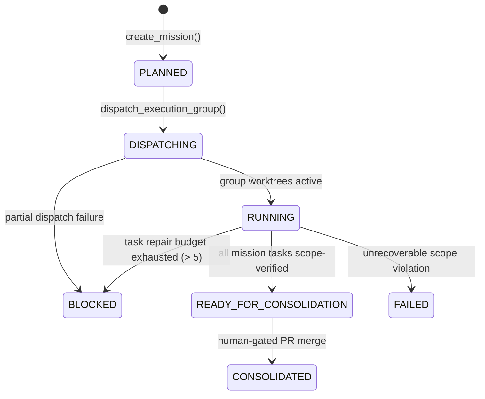
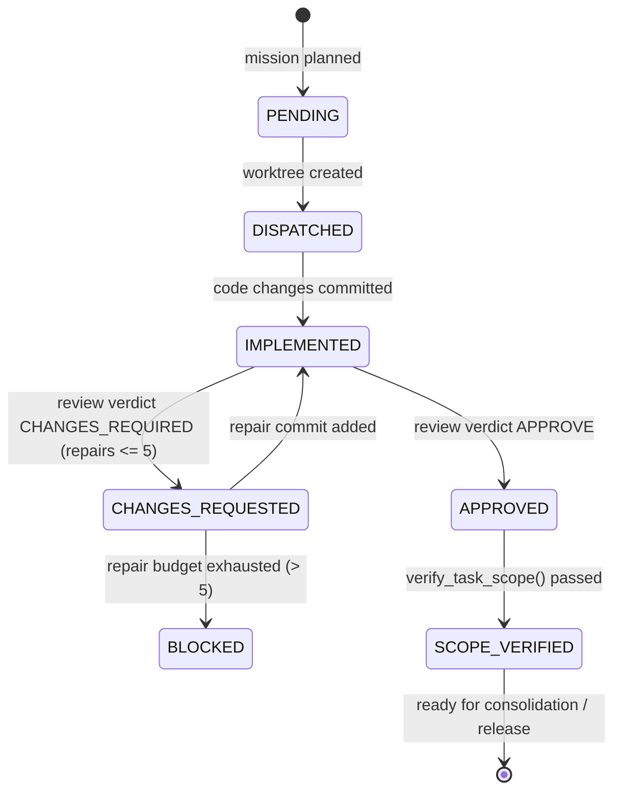

# TapJob Agent Factory — AF-2 Multi-Agent Parallel Execution & Consolidation

## 1. Overview & Objective

The TapJob Agent Factory AF-2 milestone extends the operational multi-agent capabilities established in AF-1 (formal team instantiation and isolated worktree dispatch) into an automated, deterministic framework for **Multi-Agent Parallel Execution and Consolidation Gating** under Google Antigravity 2.0.

AF-2 allows the Engineering Manager to take a high-level engineering mission, decompose it into a structured directed acyclic graph (DAG) of task contracts, partition those tasks into deterministic execution groups, execute independent tasks concurrently across isolated Git worktrees, supervise parallel repair loops with strict reviewer separation, enforce exact scope boundaries, and evaluate an automated readiness gate for branch consolidation **without performing autonomous merges**.

---

## 2. Architecture & Components

The AF-2 parallel execution subsystem is built strictly around four repository-side components and their integration with Antigravity 2.0 runtime primitives:

```
+--------------------------------------------------------------------------------------------------+
|                                    Google Antigravity 2.0                                        |
|  +--------------------+    +-----------------------+    +-------------------------------------+  |
|  |   define_subagent  |    |    invoke_subagent    |    |           send_message              |  |
|  +--------------------+    +-----------------------+    +-------------------------------------+  |
+---------------------------------------------|----------------------------------------------------+
                                              | Orchestrates
                                              v
+--------------------------------------------------------------------------------------------------+
|                                  TapJob Agent Factory (AF-2)                                     |
|                                                                                                  |
|   +-----------------------+       Deterministic       +-----------------------+                  |
|   |    MissionContract    | ------------------------> |    MissionPlanner     |                  |
|   | (schema, DAG, SHA-40) |                           |  (toposort, groups)   |                  |
|   +-----------------------+                           +-----------------------+                  |
|               |                                                   |                              |
|               | State Persistence                                 | Execution Plan               |
|               v                                                   v                              |
|   +-----------------------+  Process-Safe Lock File   +-----------------------+                  |
|   |    MissionRegistry    | <-----------------------> |  MissionCoordinator   |                  |
|   |  (atomic, multi-PID)  |                           |  (dispatch, review)   |                  |
|   +-----------------------+                           +-----------------------+                  |
|                                                                   |                              |
|                                                 Worktree Control  v                              |
|                                                       +-----------------------+                  |
|                                                       |  WorktreeDispatcher   |                  |
|                                                       | (worktrees, registry) |                  |
|                                                       +-----------------------+                  |
+--------------------------------------------------------------------------------------------------+
```

### 2.1 MissionContract (`tools/agent_factory/mission_contract.py`)
Represents an immutable, strongly typed engineering mission:
- **`mission_id`**: Non-empty identifier adhering to `^[a-zA-Z0-9_-]+$`.
- **`canonical_base_sha`**: Exact 40-character hexadecimal commit SHA pinned across the entire mission.
- **`objective`**: Human-readable definition of the intended engineering outcome.
- **`tasks`**: Ordered sequence of `TaskContract` items forming the execution DAG.
- **Strict Invariants**:
  - All child tasks inherit and must match the mission's exact `canonical_base_sha`.
  - All `task_id` values within a mission must be globally unique.
  - All `target_branch` values within a mission must be distinct.
  - Every dependency declared in `task.dependencies` must reference a valid `task_id` defined within the mission.

### 2.2 MissionPlanner (`tools/agent_factory/mission_planner.py`)
Computes an immutable `ExecutionPlan` consisting of sequential `ExecutionGroup` stages:
- **Topological Sorting & Cycle Detection**: Builds an adjacency graph and computes in-degrees. Detects dependency cycles fail-closed via DFS.
- **Critical Serial Path Isolation**: Any task whose `allowed_paths` touch `CRITICAL_SERIAL_PATHS` (such as `.agents/`, `tools/agent_guard/`, `packages/contracts/`, `infra/`, etc.) is strictly isolated into a single-task execution group (`is_parallel=False`), regardless of dependency depth.
- **Pairwise Conflict Avoidance**: Tasks in the same dependency layer are checked for path overlap (`check_ownership_conflict`). Conflicting tasks are automatically partitioned into successive execution groups to guarantee collision-free concurrent execution.
- **Determinism**: Sorting and grouping use deterministic lexical ordering on `task_id` to ensure reproducible execution plans across processes and test environments.

### 2.3 MissionRegistry (`tools/agent_factory/mission_registry.py`)
Provides persistent, crash-resilient storage for mission state outside the repository (`<worktrees_dir>/.tapjob-agent-factory/missions/<mission_id>.json`):
- **Cross-Process Mutex**: Uses directory-based lock files (`.mission_lock`) containing PID, token, and timestamp. Dead-process locks are detected and safely reclaimed via OS-level PID liveness checks (`ctypes.windll.kernel32.OpenProcess` on Windows, `os.kill(pid, 0)` on POSIX).
- **Atomic Writes**: Writes mission records to temporary files followed by atomic filesystem replacement (`os.replace`) to prevent corruption from abrupt aborts.
- **Strict Validation**: Fails closed if any registry file contains missing fields, unparseable states, or inconsistent task states.

### 2.4 MissionCoordinator (`tools/agent_factory/mission_coordinator.py`)
Executes the mission lifecycle and orchestrates worktree dispatch:
- **Group Dispatching**: Coordinates parallel worktree creation via `WorktreeDispatcher`.
- **Partial Dispatch Safe Halting**: If any task in an execution group fails to dispatch, already dispatched tasks in the group are safely recorded in their current active state, the failing task records its failure, undispatched tasks remain `PENDING`, and the mission transitions to `BLOCKED` to halt unattended progression without destroying already allocated state.
- **Reviewer Separation**: Enforces that the reviewer role cannot match the implementing owner role (`ReviewerSeparationError`).
- **Bounded Repair Loop**: Enforces `MAX_INTERNAL_REPAIR_LOOPS = 5`. On the 6th failed attempt, the task transitions to `BLOCKED` and halts autonomous dispatch, escalating to human intervention.
- **Exact TOCTOU Scope Verification**: Verifies committed diffs and working directory cleanliness against the assigned `allowed_paths`. Freezes the exact verified HEAD commit SHA.
- **Consolidation Readiness Gate**: Evaluates all tasks across the mission to ensure:
  1. All tasks are `SCOPE_VERIFIED`.
  2. Every task has a formal `APPROVE` verdict from an independent reviewer role.
  3. No task exceeded the repair budget.
  4. All worktrees remain clean with zero uncommitted changes.
  5. Current worktree HEAD matches the exact `scope_verified_head_sha` recorded during review (preventing post-review rogue commits).

---

## 3. Mission & Task Lifecycle State Machines

### 3.1 Mission State Machine (`MissionState`)



### 3.2 Task Mission State Machine (`TaskMissionState`)



---

## 4. Invariants & Safety Boundaries

1. **Strictly No Autonomous Merging**: The Agent Factory and `MissionCoordinator` evaluate readiness and report `READY_FOR_CONSOLIDATION`. Branch merging remains strictly human-gated (`gh pr merge` is prohibited in autonomous workflows).
2. **Reviewer Separation of Duties**: The task implementer can never approve their own work. Code reviews require an independent reviewer role (e.g., `reviewer_security_engineer` or `qa_sdet_engineer`).
3. **Repair Budget Guard**: Internal repair loops are strictly bounded to 5 attempts. A 6th attempt triggers an uncatchable escalation to human operators.
4. **Time-of-Check to Time-of-Use (TOCTOU) Protection**: Scope verification freezes the verified HEAD commit SHA. Any subsequent commit added to the worktree before consolidation invalidates readiness.
5. **No Direct Main Commits**: All worktree branches are restricted to feature conventions (`chore/`, `feat/`, `fix/`, `docs/`, `test/`, `security/`, `ops/`). Direct checkouts of `main` or `master` fail closed.
6. **Zero Product Alterations in Governance Scope**: AF-2 modifies zero Career Core or mobile code. It is purely agent infrastructure.
7. **OS-Backed Exclusive Locking & Fail-Closed Liveness**: Both `WorktreeDispatcher` and `MissionRegistry` utilize `DirectoryLock` (`tools/agent_factory/lock.py`). Mutual exclusion is enforced directly by the operating system kernel (`msvcrt.locking` on Windows, `fcntl.flock` on POSIX) tied to an open file handle, ensuring immediate lock release upon process termination or crash without autonomous stale directory stealing. Owner liveness inspection strictly fails closed: permission errors (POSIX `EPERM`, Windows `ERROR_ACCESS_DENIED`) and inspection errors classify processes as alive.
8. **Exact Reviewed HEAD Lifecycle Binding & Immutable Repair History**: Every transition (`IMPLEMENTED` -> `REVIEWED` -> `SCOPE_VERIFIED` -> `READY_FOR_CONSOLIDATION`) verifies that the live worktree HEAD matches the recorded, reviewed SHA. Each review iteration in `repair_records` immutably preserves its own `iteration_head_sha` rather than rewriting historical iterations with subsequent repair commit SHAs.
9. **Atomic State Transitions & Stale Writer Protection**: State transitions (`transition_task_state` and `transition_mission_state`) execute atomically under the registry mutex lock with compare-and-transition validation against `expected_states`. Stale concurrent writes fail closed with `InvalidStateTransitionError`.
10. **DAG Runtime & Dependency Enforcement**: Execution groups must proceed strictly in order; `dispatch_execution_group(i)` fails closed if any task in groups `0 .. i-1` or any declared dependency is not in `SCOPE_VERIFIED` state.
11. **Strict Schema & Semantic Repair Binding**: Registry records strictly validate list types, repair records (0-indexed contiguous `iteration_index`, exact 40-character `iteration_head_sha`, implementer/reviewer roles, test verdicts), and state machine semantic consistency (`CHANGES_REQUESTED` binds to `CHANGES_REQUIRED`, `APPROVED`/`SCOPE_VERIFIED` binds to `APPROVE`).
12. **Zero Autonomous Emergency Purge**: Unverified worktrees cannot be forcibly purged by autonomous agents. `MissionCoordinator` contains no purge bypass; manual operator interventions require out-of-band scripts strictly guarded by `tools/agent_guard/pre_tool_guard.py` (Tier C Human Gate / FORCE_ASK).

---

## 5. Live Multi-Agent Runtime Proof Evidence

A real, end-to-end multi-agent execution was performed under Google Antigravity 2.0 to validate the AF-2 architecture in live operation with real Git commits and reviewer cycles.

### 5.1 Mission Definition & Dispatch
- **Mission ID**: `af2-live-proof-round2`
- **Canonical Base SHA**: `401b7aeb51a538ca63c067f1c51891ba71bd2921`
- **Tasks**:
  1. `af2-proof-task-doc`: Assigned to `engineering_manager`, target branch `feat/af2-proof-task-doc`, allowed paths `["docs/agent-factory/proof/af2_proof_notes.md"]`.
  2. `af2-proof-task-qa`: Assigned to `qa_sdet_engineer`, target branch `feat/af2-proof-task-qa`, allowed paths `["tests/fixtures/af2_proof_fixture.json"]`.
- **Planning Result**: Group 0 contained both tasks concurrently (`parallel=True`).
- **Dispatch**:
  - Worktree 1: `C:\Projetos\tapjob-worktrees\af2-proof-task-doc` on branch `feat/af2-proof-task-doc`
  - Worktree 2: `C:\Projetos\tapjob-worktrees\af2-proof-task-qa` on branch `feat/af2-proof-task-qa`

### 5.2 Antigravity Subagent Registration & Invocation
Two specialized Antigravity subagents were defined and invoked concurrently:
1. **`af2_live_worker_doc`** (Conversation ID: `a549caca-9972-4205-852d-49ad8488a71e`):
   - Role: `AF2 Live Doc Worker`
   - Generated file: `docs/agent-factory/proof/af2_proof_notes.md`
   - Initial commit: `d691aa61f6e7d089508256f0ec9c0aad6928c829` (`feat(docs): initial draft of AF-2 parallel proof notes`)
2. **`af2_live_worker_qa`** (Conversation ID: `955b82b2-85a1-4529-aee1-c740bdb40935`):
   - Role: `AF2 Live QA Worker`
   - Generated file: `tests/fixtures/af2_proof_fixture.json`
   - Initial commit: `89ce8a1c8d6d57cd0dd0ec059b6fc2f891290150` (`feat(qa): add AF-2 parallel execution QA fixture`)

### 5.3 Repair Loop & Independent Review
- **Task 1 Review & Repair Cycle (`af2-proof-task-doc`)**:
  1. `reviewer_security_engineer` issued verdict `CHANGES_REQUIRED` (`test_passed=False`, findings: `Finding: Document lacks mandatory architecture alignment section.`). Task state transitioned to `CHANGES_REQUESTED` (`repair_count: 1`).
  2. Subagent `af2_live_worker_doc` performed repair in the worktree, adding the required architecture section and committing:
     - Repair commit: `716dd487d0fd9015c26a659141126cb8d0261343` (`fix(docs): add architecture alignment section per review finding`)
  3. `reviewer_security_engineer` re-reviewed the updated worktree and issued verdict `APPROVE` (`test_passed=True`). Task state transitioned to `APPROVED`.
- **Task 2 Review Cycle (`af2-proof-task-qa`)**:
  1. `reviewer_security_engineer` issued verdict `APPROVE` (`test_passed=True`) on first pass. Task state transitioned to `APPROVED`.

### 5.4 Exact Scope Verification & Consolidation Readiness
- Exact scope verification executed on both worktrees via `coordinator.verify_task_scope`:
  - `af2-proof-task-doc`: `SCOPE_VERIFIED` at exact repair HEAD `716dd487d0fd9015c26a659141126cb8d0261343`.
  - `af2-proof-task-qa`: `SCOPE_VERIFIED` at exact initial HEAD `89ce8a1c8d6d57cd0dd0ec059b6fc2f891290150`.
- Deterministic consolidation evaluation executed via `coordinator.check_consolidation_readiness("af2-live-proof-round2")`:
  - `ready`: `True`
  - `status`: `"READY_FOR_CONSOLIDATION"`
  - `blockers`: `[]`

### 5.5 Managed Cleanup
- Safe teardown executed via `coordinator.cleanup_mission("af2-live-proof-round2")`:
  - Verified worktrees `af2-proof-task-doc` and `af2-proof-task-qa` cleanly released and unlinked.
  - Branches `feat/af2-proof-task-doc` and `feat/af2-proof-task-qa` preserved in Git repository history with all proof commits intact.
  - Mission registry updated to `READY_FOR_CONSOLIDATION`.

---

## 6. Testing & Verification

The AF-2 test harness in `tools/agent_factory/test_mission.py` executes 47 comprehensive unit and integration scenarios:

| # | Test Scenario | Verified Invariant |
|---|---------------|--------------------|
| 1 | `test_01_mission_strict_parsing` | Validates strict boolean, string, and type parsing in `MissionContract`. |
| 2 | `test_02_human_gate_required_cannot_be_disabled` | Prohibits setting `human_gate_required=False` on missions. |
| 3 | `test_03_all_tasks_must_match_base_sha` | Rejects child tasks whose `canonical_base_sha` diverges from mission base. |
| 4 | `test_04_unique_task_ids_required` | Fails closed on duplicate `task_id` definitions within a mission. |
| 5 | `test_05_unique_target_branches_required` | Prohibits multiple tasks targeting the same branch within a mission. |
| 6 | `test_06_deterministic_topological_plan` | Computes identical, reproducible topological execution groups. |
| 7 | `test_07_dependency_cycle_detection` | Detects circular dependencies (A -> B -> A) and raises `DependencyCycleError`. |
| 8 | `test_08_missing_dependency_rejected` | Rejects tasks referencing undeclared or external dependency IDs. |
| 9 | `test_09_critical_serial_paths_isolated` | Tasks touching critical shared paths are isolated into single-task groups. |
| 10 | `test_10_conflicting_paths_partitioned` | Overlapping ownership paths in same layer are partitioned into serial stages. |
| 11 | `test_11_planner_validates_role_ownership` | Rejects tasks with paths outside owner role permissions at planning time. |
| 12 | `test_12_planner_read_only_role_with_writes_rejected` | Rejects assigning tasks with write paths to read-only roles. |
| 13 | `test_13_registry_persistence_atomic_writes` | Registry records survive reload and use atomic replacement. |
| 14 | `test_14_corrupt_registry_fails_closed` | Corrupted JSON or unparseable states in registry trigger fail-closed error. |
| 15 | `test_15_strict_registry_semantic_corruption` | Enforces structural and semantic schema constraints on registry files. |
| 16 | `test_16_duplicate_mission_id_same_process_rejected` | Atomic create-only semantics reject duplicate mission IDs in same process. |
| 17 | `test_17_duplicate_mission_id_cross_instance_rejected` | Rejects duplicate mission creation across distinct registry instances. |
| 18 | `test_18_original_mission_preserved_on_duplicate_rejection` | Original mission record remains byte/semantically intact after duplicate attempt. |
| 19 | `test_19_cross_process_locking` | Directory lock enforces single-writer mutual exclusion across processes. |
| 20 | `test_20_lock_malformed_metadata_fails_closed` | Corrupt or invalid lock metadata fails closed without blind clearing. |
| 21 | `test_21_group_dispatch_creates_worktrees` | Dispatches worktrees in parallel with correct branch and base SHA bindings. |
| 22 | `test_22_partial_dispatch_preserves_registered_and_marks_blocked` | Dispatched tasks preserved, failing task recorded, mission marked BLOCKED. |
| 23 | `test_23_task_lifecycle_review_before_implementation_rejected` | Review rejected if task has not reached IMPLEMENTED state. |
| 24 | `test_24_task_lifecycle_implementation_state_guards` | Implementation allowed only from DISPATCHED or CHANGES_REQUESTED. |
| 25 | `test_25_reviewer_separation_enforced` | Task owner cannot review their own task (`ReviewerSeparationError`). |
| 26 | `test_26_arbitrary_reviewer_role_rejected` | Reviewer role must be a registered profile with reviewer capability. |
| 27 | `test_27_strict_bool_test_passed_required` | Rejects non-strict-boolean values (truthy strings, numbers) for `test_passed`. |
| 28 | `test_28_repair_loop_accounting_via_controller` | Tracks repair iterations up to `MAX_INTERNAL_REPAIR_LOOPS = 5`. |
| 29 | `test_29_repair_attempt_6_blocked_escalated` | 6th failed attempt raises `BudgetExhaustedError` and transitions to `BLOCKED`. |
| 30 | `test_30_verify_scope_only_from_approved` | Scope verification allowed only from APPROVED state. |
| 31 | `test_31_consolidation_requires_verified_head_sha` | Unverified or mismatching HEAD SHA blocks consolidation readiness. |
| 32 | `test_32_consolidation_requires_matching_branch` | Branch mismatch between registry and worktree blocks consolidation. |
| 33 | `test_33_consolidation_requires_dispatcher_scope_verified` | Binds to WorktreeDispatcher persistent registry evidence (`scope_verified`). |
| 34 | `test_34_consolidation_requires_matching_dispatcher_head` | Dispatcher registry verified HEAD must match mission registry verified HEAD. |
| 35 | `test_35_consolidation_requires_matching_contracts` | Tampered nested task contract in dispatcher blocks consolidation readiness. |
| 36 | `test_36_toctou_head_mutation_detected` | Post-scope-verification commit added to worktree invalidates consolidation. |
| 37 | `test_37_dirty_worktree_prevents_consolidation` | Uncommitted worktree changes block consolidation readiness. |
| 38 | `test_38_all_tasks_valid_ready_for_consolidation` | When all tasks pass review and scope check, status is `READY_FOR_CONSOLIDATION`. |
| 39 | `test_39_cleanup_unresolved_clean_task_rejected` | Cleanup refuses to remove worktrees for unverified/unresolved tasks. |
| 40 | `test_40_cleanup_dirty_task_rejected` | Cleanup refuses removal if worktree has uncommitted modifications (`DirtyWorktreeError`). |
| 41 | `test_41_cleanup_scope_verified_clean_task_succeeds` | Cleanup delegates scope-verified tasks to `release_task` cleanly. |
| 42 | `test_42_duplicate_mission_does_not_poison_cache` | Rejected duplicate mission does not poison coordinator in-memory cache. |
| 43 | `test_43_post_review_recommit_attack_detected` | Re-commit attack between review and scope verify or post-verify is detected. |
| 44 | `test_44_dag_ordering_runtime_enforcement` | Dispatches next execution group only when preceding groups and dependencies are verified. |
| 45 | `test_45_os_backed_concurrent_lock` | OS-backed kernel lock mutual exclusion, fail-closed liveness, process crash recovery. |
| 46 | `test_46_strict_registry_repair_state_schema` | Registry strictly validates list types, repair records, and state semantic binding. |
| 47 | `test_47_no_emergency_purge_in_coordinator_and_guard_pattern` | Emergency purge method absent from coordinator and intercepted by PreToolGuard. |
| 48 | `test_48_repair_history_heads_immutable` | Historical review iterations preserve exact commit SHA under review (HEAD A != HEAD B). |
| 49 | `test_49_atomic_state_transitions_and_stale_writer_protection` | Concurrent reviewers and stale writers fail closed against atomic transitions. |

---

## 7. Recovery, Diagnostics & Escalation Procedures

1. **Kernel-Enforced Lock Release & Fail-Closed Recovery**: Mutual exclusion is backed by OS file locks (`msvcrt.locking` on Windows, `fcntl.flock` on POSIX). When a process dies or crashes, the OS kernel immediately and automatically frees the file handle, allowing subsequent processes to acquire the lock safely without autonomous directory stealing or rename tombstones. Owner liveness inspection strictly fails closed: permission or inspection errors treat processes as alive.
2. **Budget Exhaustion Escalation**: When a task reaches 5 failed repair iterations, the coordinator marks it `BLOCKED` and halts execution group progression. The Engineering Manager presents the findings directly to the human engineer for intervention.
3. **Dirty Worktree Protection**: If an agent process crashes leaving uncommitted files, cleanup refuses deletion (`DirtyWorktreeError`) to ensure candidate work is not destroyed.
4. **Manual Recovery Strictly Human-Gated**: Autonomous agents are strictly prohibited from forcibly purging unverified worktrees. Any manual recovery scripts or emergency purges require human operator execution and are blocked by `tools/agent_guard/pre_tool_guard.py` under autonomous execution.
5. **Registry Inspection CLI**:
   - List active missions: `python -m tools.agent_factory.bootstrap --list-missions`
   - Show mission details: `python -m tools.agent_factory.bootstrap --show-mission <mission_id>`
